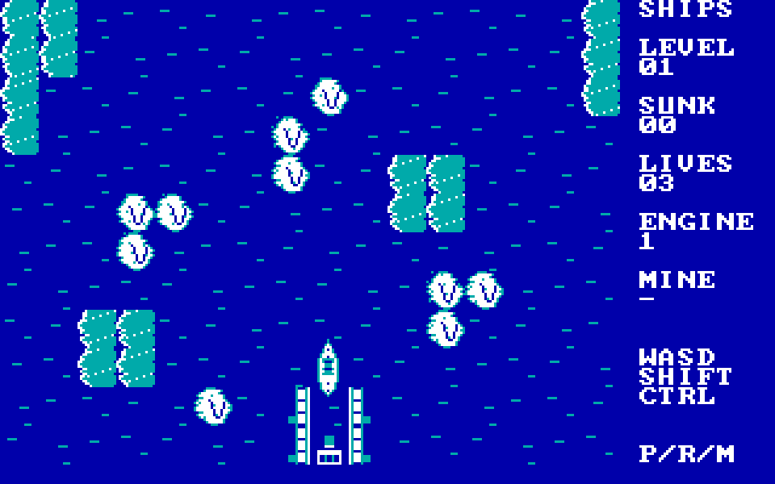
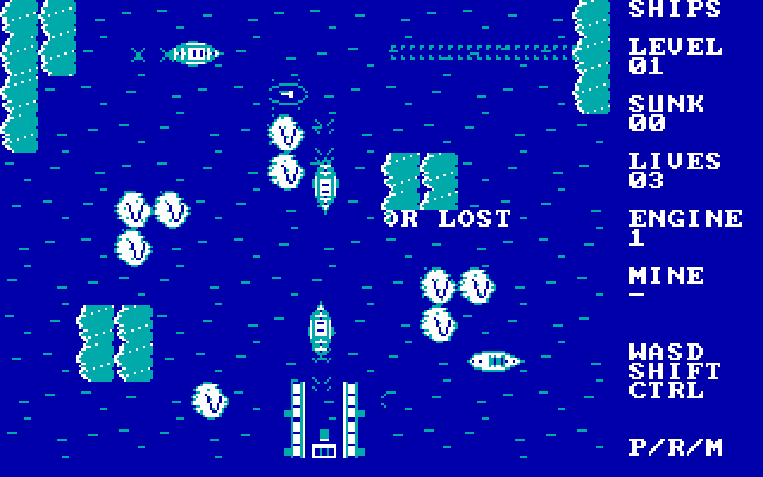

# SHIPS — Naval Harbor Defense (DOS / IBM PC XT)

**v0.7 — 12 November 2026.** A standalone, original 16-bit DOS **8086/8088 CGA** arcade naval-defense game. Developed for the IBM PC XT 4.77 MHz target. [Download the verified `SHIPS.COM` binary](dist/SHIPS.COM) (38,944 bytes, SHA256 `d3b4e9c130dfbb54effbad3d33f91d806ce4d6e93ca2aa2d50caf2e07ea2f575`).

**On SLOW1:** start **`C:\Ships\RUN-CGA.cmd`**. `RUN-XT.cmd` switches to the lower 240 cycles/ms diagnostic profile. DOSBox-X 2026.10.01 is reused from the separate TANKS installation; no TANKS files are modified. Both launchers load the exact verified `C:\Ships\SHIPS.COM`.

## Real DOSBox-X CGA captures





These are **actual CGA B800 video-memory captures** from the running 8086 executable on SLOW1, enlarged with nearest-neighbor sampling, **not concept art**. The second uses a 600-step diagnostic variant of the same game with additional simulation steps; its damaged harbor is an expected loss state without defensive play. This is visual and AI-progression evidence, not a full manually played victory or physical XT benchmark.

## What is playable

Defend your **harbor** on a 16×12 logical sea chart; **a projectile hitting the harbor immediately loses the level**. You operate a detailed top-down destroyer (24×24 CGA pixels), with pointed bow, deck guns, bridge and wake. Enemy destroyers are also sizeable hulls; submarines show faint silhouettes/periscope and launch bubbling torpedoes. Twelve opponents arrive during the first wave, up to four concurrently.

- Ocean is navigable; rocky reefs are **destroyable** by shellfire; sandbanks/land are impassable. The harbor has distinctive docks.
- **Automatic acceleration through slow, medium, full ahead** as the ship continues moving. Thrust and drift are separate: releasing direction causes gradual slowdown, not an instantaneous stop. **1/2/3 are internal speed stages, not controls.** Turning does not instantly discard previous momentum. Moving surface ships leave a visible V-shaped wake.
- The bow fires one shell at a time; another cannot launch until the old shell hits something or splashes after a limited range. A mine remains armed until detonation; only **one active mine** is allowed. Mines can destroy either side.
- Collision with another hull costs a life. Player begins with three lives and respawns while reserve remains. Enemy destroyers and submarines have independent logic, gradually gain speed, pursue the harbor and commit to obstacle detours rather than endlessly pressing into the same reef.
- PC Speaker effects; no external configuration or asset files needed. Sound can be toggled with M.

### Full controls

| Key | Function |
|---|---|
| **W A S D** | Apply thrust toward north, west, south or east; automatic slow/medium/full ahead and momentum |
| **Left/right Shift** | Fire **forward**; one active shell, limited range |
| **Ctrl** | Lay a mine; only after the previous one detonates |
| **P** | Pause/resume |
| **R** | Restart the campaign |
| **Space** | Continue after clearing a stage |
| **M** | Toggle PC Speaker effects |
| **Esc** | Exit to DOS |

## Supported hardware, tested truthfully

| Target | Current status |
|---|---|
| **8086 CGA 320×200, four colors (DOSBox-X)** | **Built; /TEST PASS; visual captures and 600-step enemy motion confirmed on SLOW1** |
| Physical **IBM PC XT 4.77 MHz CGA** | Target; **not yet tested on physical hardware**, speed not certified |
| EGA/VGA hardware displaying CGA mode 4 | Compatibility likely, **not separately accepted for v0.7** |
| Native 16-color EGA / native 256-color VGA | **Not implemented** |
| PC Speaker | Effects implemented |
| AdLib OPL2 / Sound Blaster | **Planned, not implemented**, no claim of automatic detection yet |

## Building and testing

Requires GNU `as`, `ld`, `make`, `objdump`, Python 3:

```sh
make clean all test
sha256sum dist/SHIPS.COM
```

The source is `src/ships.S` (real mode `.code16`, `.arch i8086`). Shipped image has 38,944 bytes, within the strict 56 KiB ceiling with stack margin. The deterministic DOS smoke test **`SHIPS.COM /TEST`** passed under DOSBox-X with CGA, 8086 CPU emulation and 240 cycles/ms. Do not confuse this with manual input or full-gameplay verification. Full test evidence, limits and next acceptance work: [testing](docs/TESTING.md), [development rules](AGENTS.md), [v0.7 notes](releases/v0.7/RELEASE-NOTES.md). License: MIT.

**Known gaps:** more refined visual variety and motion tuning, a fully witnessed 12-enemy manual clear, physical XT timing, native EGA/VGA drivers, optional AdLib and Sound Blaster auto detection and music are outstanding. No screenshot is represented as a physically captured XT display.
