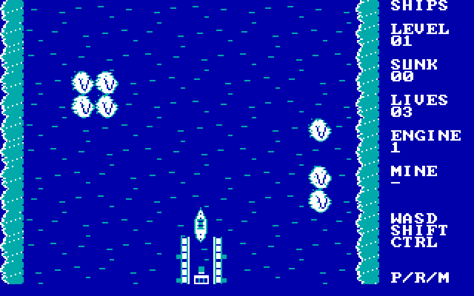
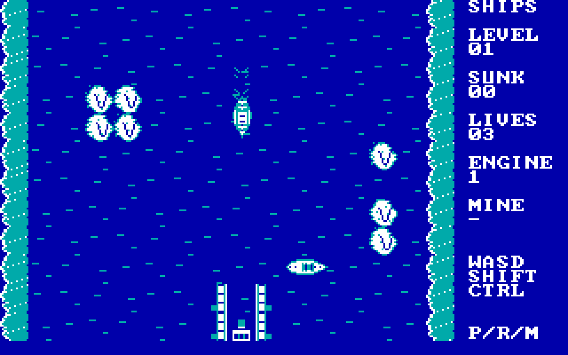

# SHIPS — Harbor Defense for IBM PC XT / CGA

**Developer release v0.8, 13 November 2026.** Standalone real-mode DOS 8086/8088 game; original top-down destroyer and submarine combat. **[Download the exact tested SHIPS.COM](dist/SHIPS.COM)** (41,172 bytes, SHA256 `4ad4cfe08e56c5c6d0c1e04855b28b4e8ac9fb727b1d1ca0dd9533ad2b8a117c`).

## Real DOSBox-X frames

These are actual DOSBox-X 8086/CGA framebuffer captures (3× nearest-neighbor display), not image-generation artwork.

## Play

On **SLOW1**, the production executable is installed at `C:\Ships\SHIPS.COM`. Run `C:\Ships\RUN-XT.cmd` for the IBM XT nominal 4.77MHz **emulator approximation** or `C:\Ships\RUN-CGA.cmd` for the faster developer profile. The old `240 cycles/ms` test profile is deliberately **not** a playable XT speed profile. Exact DOSBox cycle values are not physical XT timing proof.

- **WASD:** control the helm and thrust. The bow/heading turns with a **delayed rudder**, longer when moving fast; the destroyer automatically accelerates through slow, medium and full ahead. Releasing the keys coasts to a stop. Speed stages are *internal*, not keys.
- **Shift:** one forward shell at a time, limited travel distance and splash.
- **Ctrl:** lay a mine; no second active mine until the existing one detonates.
- **P:** pause; **R:** restart; **Space:** advance on victory; **M:** toggle PC Speaker; **Esc:** exit.

Defend the harbor against destroyers and semi-submerged submarines with torpedoes. Ocean is free to navigate; reefs are shell-destructible, shallows/land block hulls. The harbor falls immediately if struck. Three player lives. There are 12 enemies in wave 1, up to four active.

## What's fixed since v0.7

- **No visible erase–draw–erase animation:** compose on an offscreen CGA buffer then transfer marked dirty scanline spans. The player hull is not artificially blinked during invulnerability.
- **Heavy-destroyer motion:** rudder delay depending on momentum, gradual acceleration, lengthy coast; stable, visible wake.
- **Fleet separation and real navigation:** four individual 16×12 clearance-aware shortest-path flow maps and four distinct attack stations (center / port side / starboard side / submarine), timed patrols, collision spacing, no four-ship crowd on one point. Wider sea lanes fit the real 24×24 hull.
- **Fight pacing:** first spawn and successive arrivals are less frantic. NPCs aim toward harbor/player rather than firing continuously into empty ocean.
- **Less CPU wasted than the first offscreen prototype:** measured 120-step /CAP at fixed 240 emulated cycles/ms: v0.7 median 7.72s, v0.8 9.57s (+24%, test workload). This is *not* an FPS measurement or real-hardware benchmark. The earlier unoptimized buffered candidate was 13.47s on the same profile.

## Verified

- `SHIPS.COM /TEST` under DOSBox-X 2026.10.01, 8086 + CGA 320×200: **PASS**.
- 600-step unattended DOSBox-X simulation with enemy coordinates recorded at steps 100,200,300,400,500,600: **zero enemy hull overlaps** in the sampled positions, and movement to independent stations. The unattended test **loses the harbor** because the player does not defend it; this is not a witnessed human victory.
- New executable size 41,172 bytes, below the 56 KiB 8086 COM budget. Original TANKS installation is separate and untouched.
- GitHub Actions compiles the same original source `src/ships.S`, statically checks 8086 ISA and checks exact release binary checksum. See [detailed evidence](docs/TESTING.md).

**Not yet certified:** physical XT 4.77MHz speed, long manual combat victory, native EGA/VGA renderers, AdLib or Sound Blaster auto-detection/music (PC Speaker effects exist). DOSBox-X CGA mode alone does not prove physical CGA behavior.
